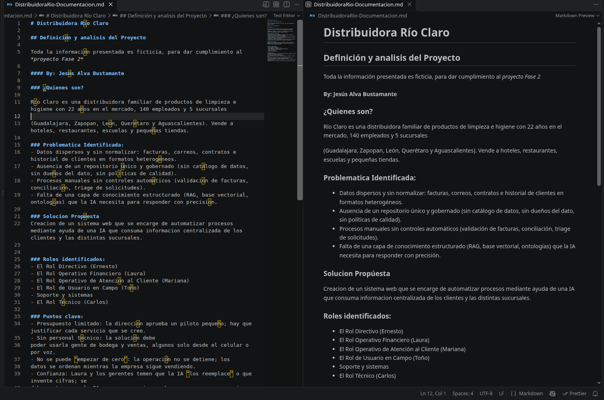

# Distribuidora Río Claro

## 1. Definición y analisis del Proyecto

Toda la información presentada es ficticia, para dar cumplimiento al *proyecto Fase 2*

#### By: Jesús Alva Bustamante

### ¿Quienes son?

Río Claro es una distribuidora familiar de productos de limpieza e higiene con 22 años en el mercado, 140 empleados y 5 sucursales 

(Guadalajara, Zapopan, León, Querétaro y Aguascalientes). Vende a hoteles, restaurantes, escuelas y pequeñas tiendas. 

### Problematica Identificada: 
- Datos dispersos y sin normalizar: facturas, correos, contratos e historial de clientes en formatos heterogéneos.
- Ausencia de un repositorio único y gobernado (sin catálogo de datos, sin dueños del dato, sin políticas de calidad).
- Procesos manuales sin controles automáticos (validación de facturas, conciliación, triage de solicitudes).
- Falta de una capa de conocimiento estructurado (RAG, base vectorial, ontologías) que la IA necesita para responder con precisión.

### Roles identificados: 
- Rol: Directivo / Administrador General (Ernesto)
- Rol: Analista / Operador de Cuentas por Pagar  (Laura)
- Rol: Gerente de Sucursal / Atención al Cliente (Mariana)
- Rol: Operador de Bodega / Almacén (Toño)
- Rol: Administrador de TI / Soporte Técnico (Carlos)

### Solucion Propúesta
Creacion de un sistema web que se encarge de automatizar procesos mediante ayuda de una IA que consuma informacion centralizada de los clientes y las distintas sucursales.

### Puntos clave: 
- Presupuesto limitado: la dirección aprueba un piloto pequeño; hay que justificar cada servicio que se cree.
- Sin personal técnico: la solución debe
poder usarla gente de bodega y ventas, algunos solo desde el celular o por voz. 
- No se puede “empezar de cero”: la operación no se detiene; los
datos se ordenan mientras la empresa sigue vendiendo. 
- Confianza: Laura y los gerentes temen que la IA “los reemplace” o que invente cifras; se
debe mostrar que la IA apoya y que siempre hay una persona que revisa.

## 2. Modulos preevistos del sistema
> EL sistema debe de contar con los siguientes modulos
### Modulo Directivos:
#### Funciones esperadas:
1. Generar Reporte de ventas para la direccion por producto
2. Filtrado de informacion del reporte por sucursal
3. Gestion de sucursales (Guadalajara, Zapopan, León, Querétaro y Aguascalientes)

### Modulo Analista
1. Extraer la informacion (proveedor, fecha y total) de los proveedores de las facturas

### Modulo Gerente de Sucursal
Lectura de archivos para extraccion de informacion mediante IA (Punto 3 apartado 1)

### Modulo Operador de Bodega

### LO que debe de incluir el modelo de IA
[]Uso desde el celular o por voz

## 3. Intervencion de IA
Centralizar la informacion dentro de One Drive para que FOundry IQ pueda acceder a las facturas
 
## Evidencia

