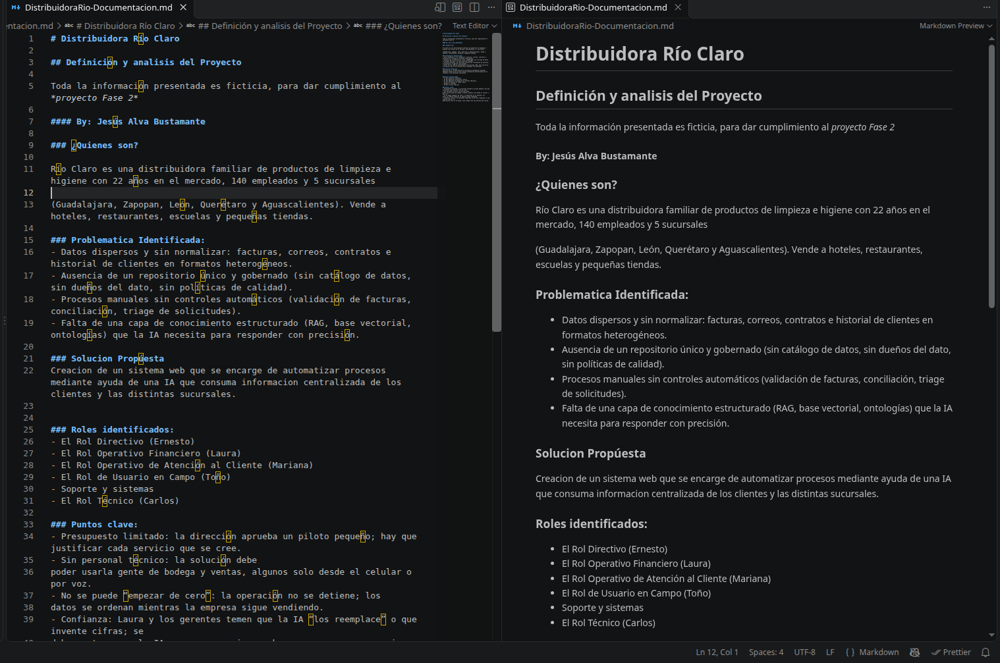

# Distribuidora Río Claro

## Navegación

- [Documentación general](0.DistribuidoraRio-Documentacion.md)
- [Módulo de Administración](1.Modulo-Admin.md)
- [Módulo de Analista](2.Modulo-Analista.md)
- [Módulo de Directivo](3.Modulo-Directivo.md)
- [Módulo de Gerente](4.Modulo-Gerente.md)
- [Módulo de Bodega](5.Modulo.Bodega.md)
- [Módulo de TI](6.Modulo-TI.md)

## Resumen del proyecto

Este documento describe el contexto de negocio, los objetivos y la solución
propuesta para el sistema web de Distribuidora Río Claro. La información de la
empresa y los ejemplos utilizados en el proyecto son ficticios y se presentan
con fines académicos para la Fase 2.

**Autor:** Jesús Alva Bustamante

## 1. Perfil de la empresa

Río Claro es una distribuidora familiar de productos de limpieza e higiene con
22 años de operación, 140 empleados y cinco sucursales:

- Guadalajara
- Zapopan
- León
- Querétaro
- Aguascalientes

Sus clientes incluyen hoteles, restaurantes, escuelas y pequeñas tiendas.

## 2. Situación actual y problema

La información y los procesos de la empresa presentan varios retos:

1. **Datos dispersos:** facturas, correos, contratos e historial de clientes
   están en formatos y ubicaciones diferentes.
2. **Información sin normalizar:** los nombres de productos y otros datos
   pueden variar entre archivos y sucursales.
3. **Gobierno de datos limitado:** hacen falta criterios compartidos de calidad,
   responsables de los datos y una fuente confiable para cada tipo de
   información.
4. **Procesos manuales:** la revisión de facturas, la atención de solicitudes y
   la organización de información dependen de tareas que pueden ser lentas y
   difíciles de rastrear.
5. **Acceso que debe segmentarse:** cada persona debe consultar únicamente la
   información correspondiente a su rol y a sus sucursales autorizadas.
6. **Confianza en la IA:** las respuestas deben basarse en fuentes
   identificables y no sustituir la revisión humana en decisiones importantes.

## 3. Objetivos y principios de diseño

El sistema busca:

- Centralizar la consulta de información operativa de facturas, inventario y
  quejas.
- Automatizar tareas repetitivas, conservando la decisión humana cuando los
  datos sean inciertos.
- Atender las cinco sucursales y separar los resultados por sucursal.
- Proporcionar herramientas distintas según el rol de cada persona.
- Mostrar las fuentes de las respuestas del asistente cuando estén disponibles.
- Mantener el alcance del piloto acotado y justificar los servicios utilizados.
- Permitir que los procesos se incorporen gradualmente, sin detener la operación.
- Ofrecer una interfaz sencilla para el personal operativo, incluido el dictado
  por voz disponible para Bodega cuando el navegador lo admita.

## 4. Roles del sistema

| Rol | Persona | Responsabilidad principal | Módulo |
| --- | --- | --- | --- |
| Directivo | Ernesto | Consultar reportes agregados de facturas y comparar sucursales autorizadas. | [Módulo de Directivo](./3.Modulo-Directivo.md) |
| Analista | Laura | Cargar facturas, validar datos extraídos y resolver revisiones pendientes. | [Módulo de Analista](./2.Modulo-Analista.md) |
| Gerente | Mariana | Consultar información operativa y dar seguimiento a quejas de sus sucursales. | [Módulo de Gerente](./4.Modulo-Gerente.md) |
| Bodega | Toño | Consultar existencias por sucursal, registrar entradas y usar consultas por voz compatibles. | [Módulo de Bodega](./5.Modulo.Bodega.md) |
| TI | Carlos | Comprobar la disponibilidad básica del backend y consultar información técnica permitida. | [Módulo de TI](./6.Modulo-TI.md) |
| Administrador | Administración | Aprobar cuentas, asignar roles y sucursales, resolver revisiones de facturas y consultar agentes. | [Módulo de Administración](./1.Modulo-Admin.md) |

El administrador es un rol de gestión de acceso adicional a los cinco roles
operativos. Los permisos de las personas usuarias se delimitan por su rol y las
sucursales asignadas.

## 5. Solución propuesta

Se implementa una aplicación web con **Next.js** en el frontend y **FastAPI**
en el backend. La aplicación ofrece inicio de sesión propio, paneles por rol y
asistentes conectados a agentes de Microsoft Foundry.

El sistema aplica controles para limitar las consultas a los roles y sucursales
autorizados. La IA apoya la búsqueda, extracción y clasificación de información;
los casos que requieren confirmación se presentan para revisión humana.

## 6. Flujos principales

### 6.1 Facturas

1. La analista carga un PDF o imagen compatible para una sucursal autorizada.
2. Document Intelligence intenta extraer los datos de la factura.
3. El sistema detecta duplicados y evalúa si los campos extraídos son
   suficientemente confiables.
4. Los documentos confiables se almacenan y se indexan para su consulta.
5. Los documentos incompletos, inciertos o potencialmente duplicados quedan en
   la bandeja de revisión.
6. La analista o el administrador compara el original con el proveedor, la fecha
   y el total; después aprueba o declina el documento.

La automatización no sustituye la validación humana de los documentos dudosos.

### 6.2 Inventario

- El personal de Bodega consulta el inventario filtrado por sucursales asignadas.
- Puede registrar un producto o sumar unidades al stock existente. 
- El sistema mantiene la información de sucursal y rol en los índices usados para la consulta
directa y para el agente de Bodega.

### 6.3 Quejas y sugerencias

Los clientes pueden enviar nombre, correo, sucursal y mensaje desde el
formulario público, sin iniciar sesión. El backend guarda la queja y solicita al
agente de Gerente una categoría, un resumen y un punto crítico. La gerente revisa
el mensaje original y actualiza el estado de atención. Si el análisis automático
no está disponible, la queja se conserva para triage manual.

### 6.4 Consultas con agentes

Cada rol operativo consulta su agente con las sucursales autorizadas. Las
respuestas deben apoyarse en los documentos disponibles y mostrar las citas
cuando el agente las proporcione. El cambio de sucursales inicia un contexto de
conversación nuevo.

## 7. Organización y tratamiento de datos

| Necesidad | Acción o tratamiento | Componente utilizado |
| --- | --- | --- |
| Conservar originales de facturas | Guardar los documentos cargados en un contenedor organizado por sucursal. | Azure Blob Storage |
| Extraer datos de documentos | Analizar facturas y obtener campos como proveedor, fecha y total. | Azure AI Document Intelligence |
| Consultar información autorizada | Indexar documentos con atributos de rol (`security_id`) y sucursal (`branch`) para filtrar resultados. | Azure AI Search |
| Administrar catálogo y existencias | Mantener productos y cantidades por sucursal; uniformar nombres mediante datos y sinónimos configurados. | Índices de Azure AI Search y archivos de configuración |
| Administrar cuentas y solicitudes | Guardar usuarios, roles, sucursales y estados de acceso. | SQLite y SQLAlchemy |
| Registrar y atender quejas | Guardar el mensaje original, estado y resultado de análisis cuando esté disponible. | SQLite y agente de Gerente en Microsoft Foundry |
| Responder consultas por rol | Configurar agentes operativos con instrucciones y filtros de rol y sucursal. | Microsoft Foundry |
| Proteger el acceso | Usar contraseñas con hash y tokens JWT; no compartir secretos con los agentes. | FastAPI, JWT y credenciales administradas por el entorno |

La propuesta inicial identificó además la necesidad de consolidar un catálogo
maestro de productos, elegir versiones vigentes de políticas y definir
responsables y reglas de calidad para cada fuente. Estas son tareas de gobierno
de datos que deben mantenerse como parte de la evolución del piloto; no se debe
asumir que todos los datos empresariales ya están normalizados.

## 8. Arquitectura de la aplicación

| Capa | Responsabilidad |
| --- | --- |
| Frontend | Aplicación Next.js, autenticación de interfaz, paneles por rol, formularios, bandejas y chat. |
| API | FastAPI valida sesiones, permisos, sucursales y solicitudes; coordina las operaciones con la base de datos y servicios Azure. |
| Base de datos local | SQLite almacena cuentas, cargas de facturas y quejas con sus estados. |
| Procesamiento documental | Blob Storage conserva originales; Document Intelligence analiza facturas; Azure AI Search indexa documentos consultables. |
| Agentes de IA | Microsoft Foundry ofrece agentes con instrucciones específicas y acceso filtrado a la búsqueda. |

## 9. Implementación y preparación del piloto

Antes de conectar nuevas fuentes a los agentes:

1. Identificar las fuentes de datos y sus responsables.
2. Separar documentos por tipo, sucursal y nivel de acceso.
3. Definir los datos maestros y los nombres canónicos necesarios.
4. Marcar las fuentes vigentes y retirar versiones obsoletas de la consulta.
5. Verificar los campos de seguridad y los filtros antes de publicar documentos.
6. Probar extracción, búsqueda y permisos con datos ficticios o autorizados.
7. Mantener una ruta de revisión humana para los resultados incompletos.

Los scripts de preparación y carga, las variables de entorno requeridas y los
comandos de pruebas se describen en el [README de scripts del backend](../backend/scripts/README.md).

## 10. Evidencia de recursos Azure

Los siguientes enlaces corresponden a los recursos documentados para el piloto.
El estado actual de cada recurso debe comprobarse en Azure antes de ejecutar
cargas o modificar configuración.

### Grupo de recursos

[Ver grupo de recursos `rg-rioclaro-data-piloto`](https://portal.azure.com/#resource/subscriptions/8a105d2e-7fed-45bc-bb81-83c1cd12488b/resourceGroups/rg-rioclaro-data-piloto/overview)

Agrupa los recursos Azure del piloto.

### Azure Blob Storage

[Ver cuenta de almacenamiento `strioclarofacturas`](https://portal.azure.com/#resource/subscriptions/8a105d2e-7fed-45bc-bb81-83c1cd12488b/resourceGroups/rg-rioclaro-data-piloto/providers/Microsoft.Storage/storageAccounts/strioclarofacturas/overview)

Revisar el contenedor `facturas-raw`, destinado a los originales de facturas.

### Azure AI Document Intelligence

[Ver recurso `di-rioclaro-facturas`](https://portal.azure.com/#resource/subscriptions/8a105d2e-7fed-45bc-bb81-83c1cd12488b/resourceGroups/rg-rioclaro-data-piloto/providers/Microsoft.CognitiveServices/accounts/di-rioclaro-facturas/overview)

Servicio utilizado por el flujo de análisis de facturas. Document Intelligence
Studio permite probar documentos de manera visual.

### Azure AI Search

[Ver servicio `srch-rioclaro`](https://portal.azure.com/#resource/subscriptions/8a105d2e-7fed-45bc-bb81-83c1cd12488b/resourceGroups/rg-rioclaro-data-piloto/providers/Microsoft.Search/searchServices/srch-rioclaro/overview)

Revisar los índices y verificar que los documentos utilicen los campos de
segmentación por rol y sucursal configurados para el sistema.

### Microsoft Foundry

[Ver recurso `foundry-rioclaro-575`](https://portal.azure.com/#resource/subscriptions/8a105d2e-7fed-45bc-bb81-83c1cd12488b/resourceGroups/rg-rioclaro-data-piloto/providers/Microsoft.CognitiveServices/accounts/foundry-rioclaro-575/overview)

Desde el portal del proyecto se administran los agentes operativos. El nombre
del recurso incluye el sufijo `575` por disponibilidad del nombre.

### Azure Key Vault

[Ver bóveda `kv-rioclaro-piloto`](https://portal.azure.com/#resource/subscriptions/8a105d2e-7fed-45bc-bb81-83c1cd12488b/resourceGroups/rg-rioclaro-data-piloto/providers/Microsoft.KeyVault/vaults/kv-rioclaro-piloto/overview)

Recurso destinado a la gestión de secretos. No incluir claves, tokens ni valores
secretos en este documento, en el código fuente o en archivos versionados.

## 11. Documentación relacionada

- [Módulo de Administración](./1.Modulo-Admin.md)
- [Módulo de Analista](./2.Modulo-Analista.md)
- [Módulo de Directivo](./3.Modulo-Directivo.md)
- [Módulo de Gerente](./4.Modulo-Gerente.md)
- [Módulo de Bodega](./5.Modulo.Bodega.md)
- [Módulo de TI](./6.Modulo-TI.md)
- [Evidencia de la capa de datos](../evidencia-img/Ejecucion-V1-Capa-de-datos.md)
- [Evidencia de agentes y backend](../evidencia-img/Ejecucion-V2-Creacion-de-agentes-en-foundryybackend.md)

