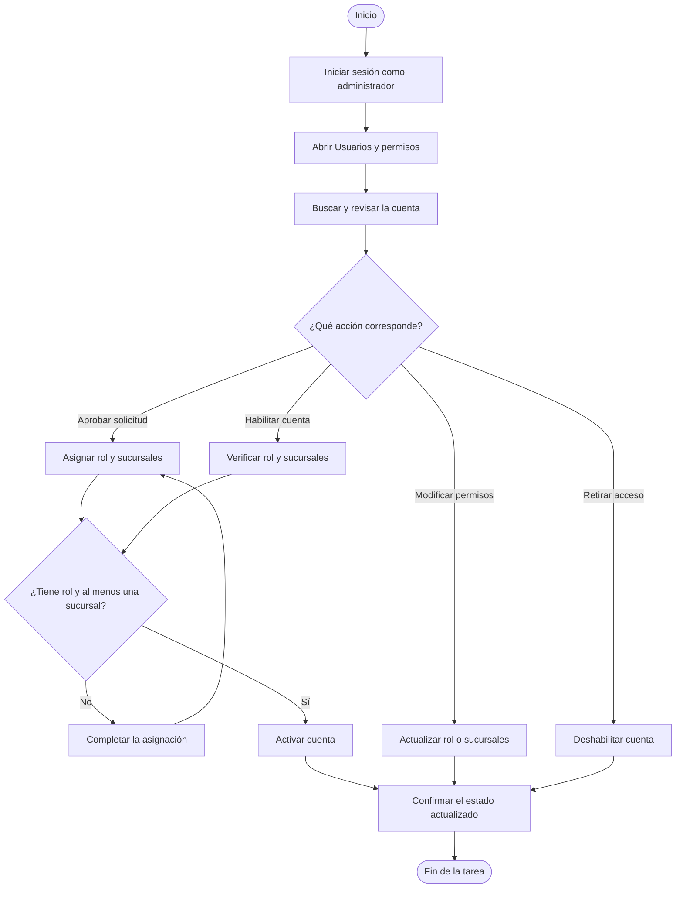
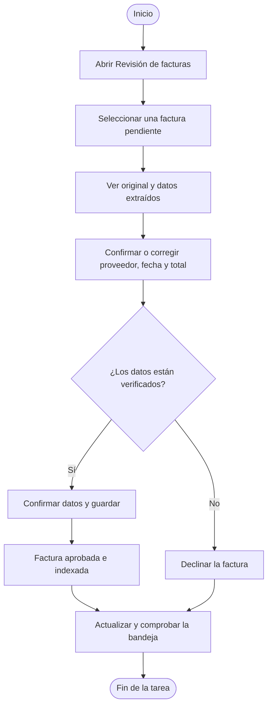
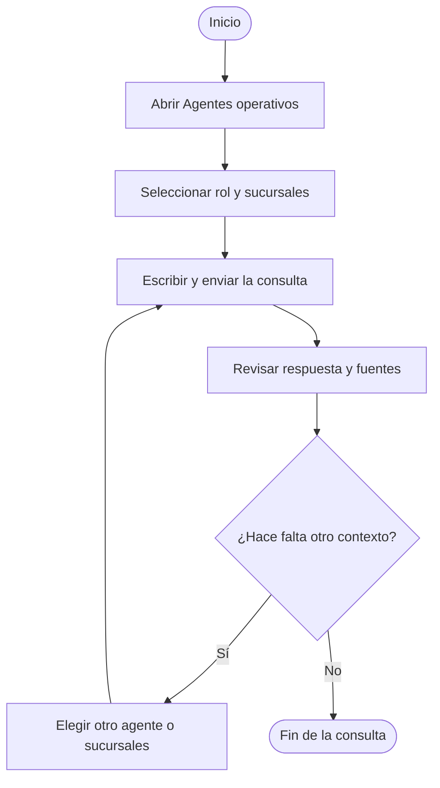
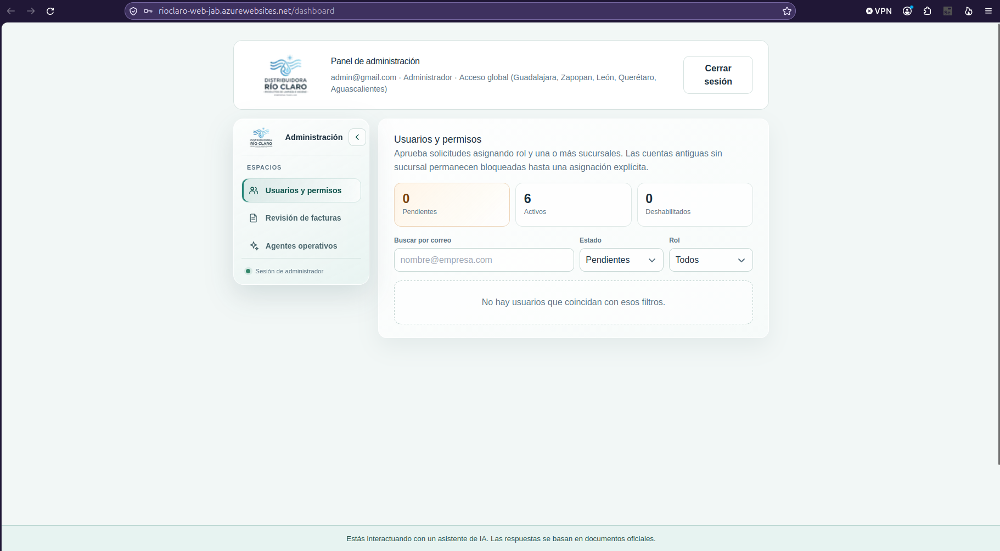
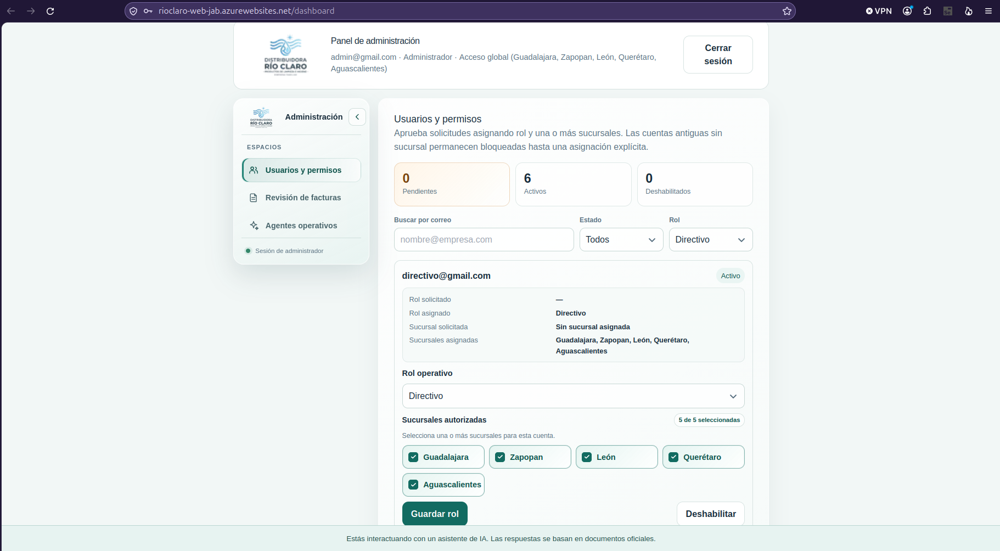
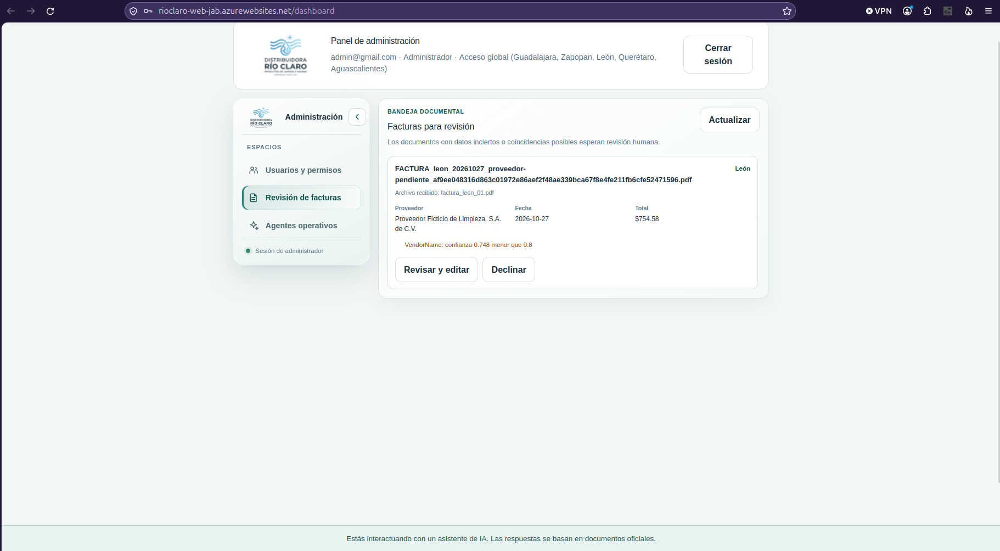
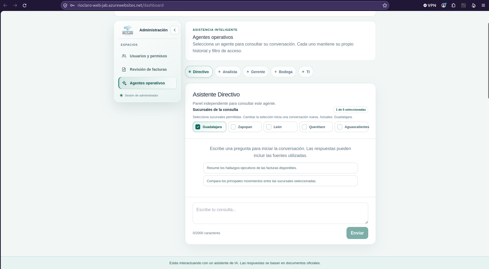

# Módulo de Administración

## Navegación

- [Documentación general](0.DistribuidoraRio-Documentacion.md)
- [Módulo de Administración](1.Modulo-Admin.md)
- [Módulo de Analista](2.Modulo-Analista.md)
- [Módulo de Directivo](3.Modulo-Directivo.md)
- [Módulo de Gerente](4.Modulo-Gerente.md)
- [Módulo de Bodega](5.Modulo.Bodega.md)
- [Módulo de TI](6.Modulo-TI.md)

## Índice

- [Objetivo](#objetivo)
- [Flujo del módulo: inicio a fin](#flujo-del-módulo-inicio-a-fin)
  - [Gestión de cuentas y permisos](#gestión-de-cuentas-y-permisos)
  - [Revisión de facturas](#revisión-de-facturas)
  - [Consulta de agentes](#consulta-de-agentes)
- [Acciones del administrador](#acciones-del-administrador)
  - [1. Revisar solicitudes de acceso](#1-revisar-solicitudes-de-acceso)
  - [2. Mantener permisos de usuarios](#2-mantener-permisos-de-usuarios)
  - [3. Revisar facturas que requieren intervención](#3-revisar-facturas-que-requieren-intervención)
  - [4. Consultar agentes operativos](#4-consultar-agentes-operativos)
  - [5. Cerrar la sesión](#5-cerrar-la-sesión)
- [Alcance y restricciones](#alcance-y-restricciones)

## Objetivo

Administrar las cuentas, los permisos por rol y sucursal, la revisión de facturas
pendientes y el acceso de consulta a los agentes operativos.

El rol de administrador es distinto de los roles operativos. Su cuenta inicial se
crea mediante el procedimiento de administración del sistema; no se solicita
desde el formulario público de registro.

## Flujo del módulo: inicio a fin

El panel no ejecuta una sola secuencia obligatoria: después de iniciar sesión,
el administrador elige una de las tareas independientes.

### Gestión de cuentas y permisos

### Revisión de facturas

### Consulta de agentes

## Acciones del administrador

### 1. Revisar solicitudes de acceso

1. Iniciar sesión con una cuenta de administrador habilitada.
2. Abrir **Usuarios y permisos**.
3. Buscar cuentas por correo y filtrar la lista por estado o rol cuando sea
   necesario.
4. Revisar el rol y la sucursal solicitados por la persona.
5. Seleccionar el rol operativo que debe tener la cuenta y una o más sucursales
   autorizadas.
6. Usar **Asignar rol y aprobar** para activar una solicitud pendiente.
7. Confirmar que la cuenta figure como activa y que las sucursales asignadas
   correspondan a su ámbito de trabajo.

Una cuenta operativa no debe habilitarse sin rol y al menos una sucursal
asignados. La sucursal solicitada por el usuario es una referencia para la
revisión; el administrador asigna los permisos efectivos.

#### PANTALLA - Aprobacion de solicitudes de usuarios

### 2. Mantener permisos de usuarios

1. Localizar la cuenta en **Usuarios y permisos**.
2. Cambiar el rol operativo o las sucursales asignadas cuando haya una
   autorización para hacerlo.
3. Guardar los cambios y verificar el aviso de confirmación.
4. Deshabilitar el acceso de una cuenta cuando deba dejar de ingresar al
   sistema; habilitarla de nuevo únicamente después de verificar que cuenta con
   rol y sucursales asignados.

La lista distingue cuentas pendientes, activas y deshabilitadas. La cuenta de
administración no se modifica desde esta pantalla.

#### PANTALLA - Permisos de usuarios

### 3. Revisar facturas que requieren intervención

1. Abrir **Revisión de facturas**.
2. Consultar los documentos pendientes, sus datos extraídos y los motivos por
   los que requieren revisión.
3. Abrir la vista previa y comparar el documento original con el proveedor, la
   fecha y el total detectados.
4. Corregir o confirmar esos tres campos antes de aprobar.
5. Elegir **Confirmar datos y guardar** para aprobar e indexar la factura, o
   **Declinar** para rechazarla.
6. Actualizar la bandeja y confirmar que el documento ya no aparezca pendiente.

El administrador puede resolver revisiones de facturas, pero esta pantalla no
permite cargar facturas nuevas.

#### PANTALLA - Validacion de facturas

### 4. Consultar agentes operativos

1. Abrir **Agentes operativos**.
2. Elegir el rol del agente que se desea consultar.
3. Seleccionar una o más sucursales autorizadas para esa consulta.
4. Escribir la pregunta y revisar la respuesta y las fuentes que presente el
   asistente.
5. Cambiar de sucursal o de agente cuando la consulta requiera otro contexto.
   Cambiar las sucursales inicia una conversación nueva.

La selección de un agente no cambia los permisos del administrador ni permite
eludir los filtros de rol y sucursal aplicados a los datos.

### 5. Cerrar la sesión

Usar **Cerrar sesión** al terminar. El token de sesión se elimina del navegador.

## Alcance y restricciones

- La cuenta de administrador tiene acceso global a las cinco sucursales para las
  funciones administrativas disponibles.
- La asignación efectiva de acceso a los usuarios operativos se delimita por sus
  sucursales y rol.
- La bandeja de quejas es una función del rol Gerente, no una sección del panel
  de Administración.
- El panel no ofrece creación o edición directa de documentos del índice,
  configuración de Azure ni administración de contraseñas de otras cuentas.