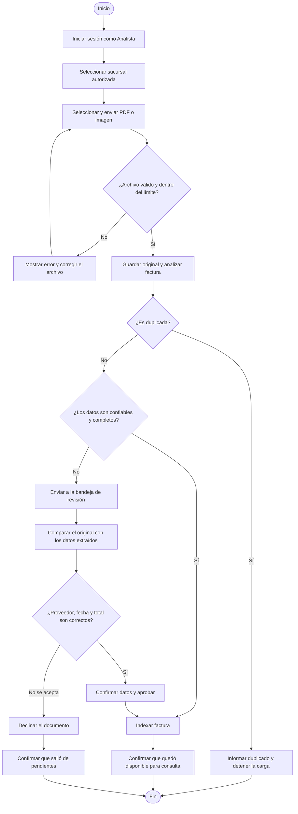
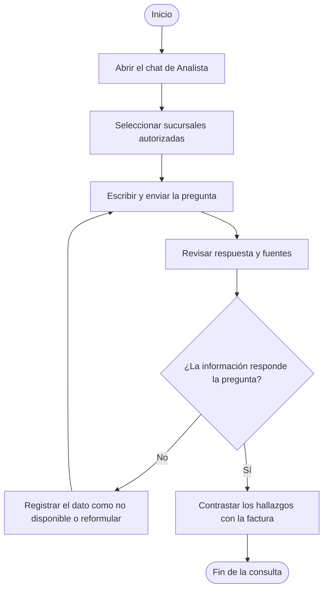

# Módulo de Analista

## Navegación

- [Documentación general](0.DistribuidoraRio-Documentacion.md)
- [Módulo de Administración](1.Modulo-Admin.md)
- [Módulo de Analista](2.Modulo-Analista.md)
- [Módulo de Directivo](3.Modulo-Directivo.md)
- [Módulo de Gerente](4.Modulo-Gerente.md)
- [Módulo de Bodega](5.Modulo.Bodega.md)
- [Módulo de TI](6.Modulo-TI.md)

## Responsable

Laura, en el rol operativo **Analista**.

## Objetivo

Procesar facturas, validar la extracción automática y dejar los documentos con
datos confiables disponibles para consulta, manteniendo revisión humana cuando
la extracción sea incompleta o incierta.

## Flujo del módulo: inicio a fin

La analista puede procesar una factura o iniciar una consulta independiente con
el asistente.

### Carga y revisión de una factura

Si el análisis o la validación del archivo falla, se muestra el error para que
la analista lo corrija. Una factura que queda en revisión no se considera
indexada hasta que se apruebe.

### Consulta al asistente

## Acciones de la analista

### 1. Iniciar sesión y verificar el alcance

1. Iniciar sesión con la cuenta activa de Analista.
2. Revisar que las sucursales mostradas correspondan a las asignadas a su
   cuenta.
3. Seleccionar en el formulario la sucursal a la que pertenece la factura.

La API solo acepta la carga para una sucursal autorizada a la cuenta.

### 2. Cargar una factura

1. Abrir **Facturas para revisión**.
2. Seleccionar la sucursal de la factura.
3. Elegir un PDF o imagen compatible, de hasta 20 MB.
4. Enviar el archivo y esperar el resultado del procesamiento.
5. Si se confirma la indexación, guardar el nombre generado y revisar que el
   documento esté disponible para las consultas autorizadas.
6. Si el sistema indica que la factura es duplicada, no volver a cargarla sin
   verificar primero el documento existente.

El sistema conserva el original, intenta extraer proveedor, fecha y total con
Document Intelligence, y comprueba duplicados. Los documentos procesados se
asocian a su sucursal y a los roles autorizados.

### 3. Resolver documentos pendientes de revisión

1. Consultar la bandeja **Facturas para revisión**.
2. Leer los motivos señalados, como campos faltantes, confianza insuficiente,
   varias facturas dentro de un archivo o una posible coincidencia.
3. Abrir **Revisar y editar** para comparar la vista previa con los datos
   detectados.
4. Confirmar o corregir proveedor, fecha de factura y total en MXN usando el
   documento original como fuente.
5. Aprobar solo cuando los tres campos sean correctos; al aprobar, la factura
   se indexa para consulta.
6. Declinar el documento cuando no deba aceptarse como factura válida para el
   índice.
7. Actualizar la bandeja y revisar el resultado de la operación.

Una factura con datos dudosos no debe tratarse como verificada. La extracción
automática apoya el trabajo, pero no sustituye la comprobación humana.

### 4. Consultar al asistente de Analista

1. Seleccionar las sucursales autorizadas que deben incluirse en la consulta.
2. Preguntar por proveedor, fecha, productos, total o campos que necesiten
   revisión.
3. Revisar la respuesta junto con las fuentes citadas y contrastar los
   hallazgos con la factura.
4. Si el asistente no encuentra un dato o una fuente, registrarlo como no
   disponible en vez de completar la cifra por inferencia.

El chat acepta mensajes de 1 a 2.000 caracteres y conserva el contexto de la
conversación mientras se mantengan el agente y las sucursales seleccionadas.

## Alcance y restricciones

- La analista puede cargar y resolver revisiones de facturas dentro de las
  sucursales asignadas.
- Los PDF e imágenes admitidos deben pesar 20 MB o menos.
- La información de la factura se considera lista para consulta únicamente
  después de indexarse; los casos inciertos esperan decisión humana.
- El asistente consulta documentos autorizados y puede mostrar citas. La
  analista debe contrastar los datos antes de aprobar o comunicar conclusiones.