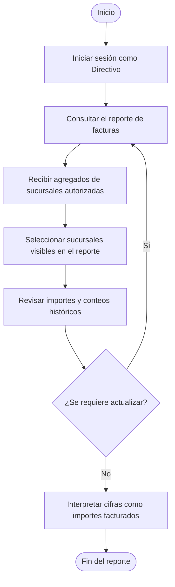
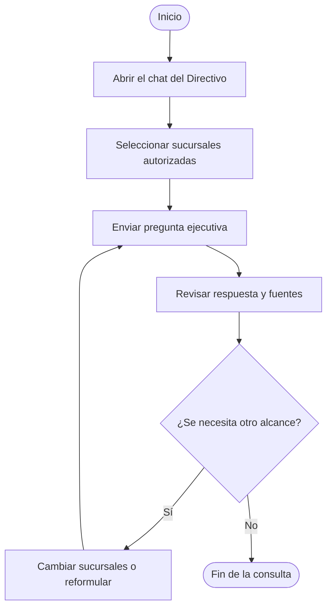

# Módulo de Directivo

## Navegación

- [Documentación general](0.DistribuidoraRio-Documentacion.md)
- [Módulo de Administración](1.Modulo-Admin.md)
- [Módulo de Analista](2.Modulo-Analista.md)
- [Módulo de Directivo](3.Modulo-Directivo.md)
- [Módulo de Gerente](4.Modulo-Gerente.md)
- [Módulo de Bodega](5.Modulo.Bodega.md)
- [Módulo de TI](6.Modulo-TI.md)

## Responsable

Ernesto, en el rol operativo **Directivo**.

## Objetivo

Consultar un resumen ejecutivo de las facturas procesadas en las sucursales
autorizadas y utilizar el asistente para explorar los documentos disponibles.

## Flujo del módulo: inicio a fin

Después de iniciar sesión, el directivo puede consultar el reporte o abrir una
conversación con el agente. Son flujos separados.

### Consulta del reporte

El reporte presenta los datos agregados que devuelve el backend para las
sucursales autorizadas; el filtro de sucursales del panel limita cuáles de esos
resultados se muestran. No representa ventas cobradas ni utilidad.

### Consulta al asistente

## Acciones del directivo

### 1. Consultar el resumen ejecutivo

1. Iniciar sesión con la cuenta activa de Directivo.
2. Revisar el reporte de facturas que aparece en el panel.
3. Seleccionar una o más sucursales autorizadas para comparar sus resultados.
4. Consultar el importe facturado, el número de facturas procesadas y la
   sucursal con el mayor importe identificado.
5. Revisar el comparativo por sucursal y actualizar el reporte cuando se
   requieran datos recientes.
6. Antes de tomar una decisión, verificar el periodo y la cobertura del reporte.

El reporte indica moneda MXN y periodo histórico acumulado. Incluye facturas con
estado `indexed` o `approved`; presenta conteos e importes extraídos de esos
documentos.

### 2. Interpretar correctamente las cifras

- Tratar los importes como valores registrados en las facturas procesadas, no
  como ventas cobradas, ingresos netos, utilidad ni conciliación contable.
- Considerar cuántas facturas tienen importe identificado; algunas pueden no
  tener un total reconocido.
- Comparar sucursales solo dentro de las autorizadas a la cuenta.
- Solicitar validación a la persona responsable cuando una cifra dependa de una
  factura dudosa o pendiente de revisión.

### 3. Consultar al asistente de Directivo

1. Abrir el chat del asistente desde el control de conversación del panel.
2. Seleccionar las sucursales autorizadas para el análisis.
3. Preguntar por tendencias, comparaciones o hallazgos ejecutivos en las
   facturas disponibles.
4. Revisar las fuentes citadas y distinguir los datos observados de las
   conclusiones del asistente.
5. Cerrar el chat al terminar la consulta.

El asistente debe basar los reportes en la información encontrada y señalar
cuando no haya datos suficientes. No se deben tratar respuestas sin fuente o
datos no disponibles como cifras verificadas.

## Alcance y restricciones

- El reporte es histórico y agrega documentos de factura; no ofrece por sí solo
  un corte por fechas, periodo contable o estado de pago.
- Solo se incluyen las sucursales asignadas a la cuenta.
- Las facturas pendientes de revisión no forman parte del total agregado hasta
  que se aprueben e indexen.
- El chat consulta las fuentes autorizadas para las sucursales elegidas.