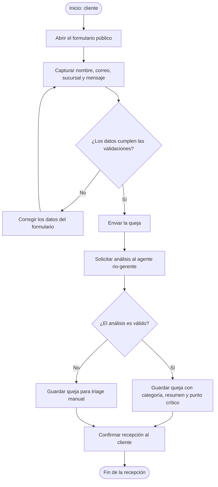
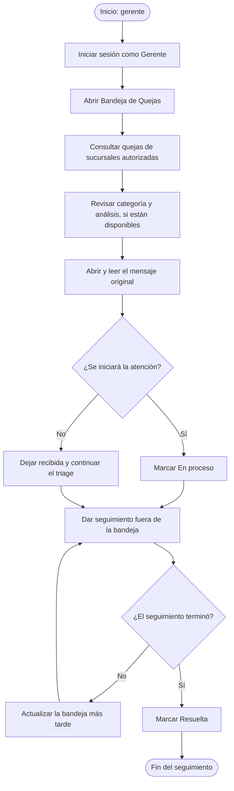

# Módulo de Gerente

## Navegación

- [Documentación general](0.DistribuidoraRio-Documentacion.md)
- [Módulo de Administración](1.Modulo-Admin.md)
- [Módulo de Analista](2.Modulo-Analista.md)
- [Módulo de Directivo](3.Modulo-Directivo.md)
- [Módulo de Gerente](4.Modulo-Gerente.md)
- [Módulo de Bodega](5.Modulo.Bodega.md)
- [Módulo de TI](6.Modulo-TI.md)

## Responsable

Mariana, en el rol operativo **Gerente**.

## Objetivo

Consultar información operativa de las sucursales asignadas y atender las
quejas de clientes con apoyo de clasificación y resumen automáticos.

## Flujo del módulo: inicio a fin

El módulo reúne dos procesos con actores y puntos de inicio diferentes: el
cliente presenta la queja sin autenticación y la gerente inicia sesión para
atenderla.

### Recepción de quejas del cliente

### Atención de la queja por la gerente

Si el análisis automático falla, la queja sigue disponible y la gerente debe
clasificarla a partir del mensaje original.

## Acciones de la gerente

### 1. Consultar documentos y proveedores

1. Iniciar sesión con la cuenta activa de Gerente.
2. Seleccionar en el chat las sucursales autorizadas para la consulta.
3. Preguntar por facturas, proveedores, montos o conceptos documentados.
4. Revisar las fuentes citadas antes de usar los hallazgos para una decisión
   operativa.
5. Solicitar un resumen o comparación cuando ayude a preparar el seguimiento.

El asistente no debe completar información que no aparezca en las fuentes. Si no
hay datos para responder, se debe dejar constancia de esa limitación.

### 2. Recibir y dar seguimiento a quejas

Los clientes pueden enviar una queja desde **Soy Cliente - Levantar Queja** en
la pantalla de acceso, sin iniciar sesión. El formulario solicita nombre, correo,
sucursal y un mensaje de 10 a 5.000 caracteres. Al recibirla, el sistema intenta
analizarla con el agente `rio-gerente` para obtener una categoría, un resumen y
un punto crítico.

La gerente debe:

1. Abrir **Bandeja de Quejas** y revisar solo las quejas de las sucursales
   asignadas a su cuenta.
2. Actualizar la bandeja manualmente o esperar su actualización automática
   periódica.
3. Leer la sucursal, fecha, datos de contacto, categoría, resumen de IA y punto
   crítico.
4. Abrir **Ver mensaje original** para comprobar el contexto completo antes de
   responder o decidir una acción.
5. Cambiar una queja recibida a **En proceso** cuando comience su atención.
6. Marcarla como **Resuelta** cuando el seguimiento haya terminado.
7. Si el análisis automático no estuvo disponible, clasificarla y atenderla
   manualmente a partir del mensaje original.

Las categorías posibles son demora, mala atención, producto, facturación,
sugerencia y otro. El resumen y el punto crítico son apoyo para el triage; no
sustituyen el mensaje original ni la revisión de la gerente.

## Alcance y restricciones

- La bandeja solo devuelve quejas de las sucursales autorizadas y está protegida
  para el rol Gerente.
- El formulario público no requiere autenticación. La gerente no necesita crear
  una cuenta para que el cliente pueda presentar su queja.
- Si Foundry no puede analizar una queja, el sistema la conserva para revisión
  manual y la marca con análisis fallido.
- La interfaz permite cambiar el estado a En proceso o Resuelta, y abrir el
  correo del cliente desde su dirección; no incluye un sistema interno de
  respuesta ni eliminación de quejas.