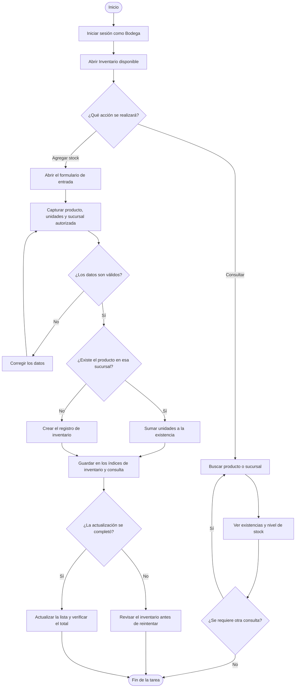
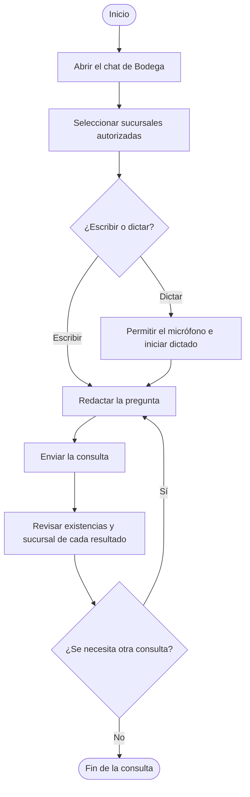

# Módulo de Bodega

## Navegación

- [Documentación general](0.DistribuidoraRio-Documentacion.md)
- [Módulo de Administración](1.Modulo-Admin.md)
- [Módulo de Analista](2.Modulo-Analista.md)
- [Módulo de Directivo](3.Modulo-Directivo.md)
- [Módulo de Gerente](4.Modulo-Gerente.md)
- [Módulo de Bodega](5.Modulo.Bodega.md)
- [Módulo de TI](6.Modulo-TI.md)

## Responsable

Toño, en el rol operativo **Bodega**.

## Objetivo

Consultar las existencias por sucursal, registrar entradas de inventario y
preguntar al asistente por los productos disponibles sin mezclar datos de
sucursales distintas.

## Flujo del módulo: inicio a fin

Después de iniciar sesión, el operador elige entre consultar existencias,
registrar stock o preguntar al asistente.

### Consulta y actualización del inventario

### Consulta al asistente

## Acciones del operador de bodega

### 1. Consultar existencias

1. Iniciar sesión con la cuenta activa de Bodega.
2. Abrir **Inventario disponible** y confirmar las sucursales a las que tiene
   acceso.
3. Buscar por nombre de producto o sucursal.
4. Revisar las existencias agrupadas por sucursal y las etiquetas de
   disponibilidad.
5. Usar **Actualizar** para volver a consultar el índice de inventario.
6. Priorizar la revisión física de los productos marcados con stock bajo o
   agotado.

El panel calcula como stock bajo una existencia de 15 unidades o menos. La suma
de unidades y el número de productos encontrados corresponden a los resultados
de la búsqueda actual.

### 2. Registrar una entrada o agregar stock

1. Abrir **Agregar stock**.
2. Escribir el nombre del producto.
3. Capturar una cantidad entera positiva de unidades.
4. Seleccionar una sucursal asignada a la cuenta.
5. Guardar y verificar el total informado por el sistema.
6. Actualizar la lista para comprobar el registro en la sucursal correcta.

Si el producto ya existe para esa sucursal, la cantidad capturada se suma al
stock existente. Si no existe, el sistema registra un producto nuevo. La
actualización se replica en los índices de inventario y de consulta del agente;
si el servicio informa un error, confirmar el inventario antes de volver a
intentar la operación.

### 3. Consultar al asistente de Bodega

1. Abrir el chat del asistente de Bodega.
2. Seleccionar una o más sucursales autorizadas.
3. Preguntar por existencias, cantidades o productos específicos.
4. Revisar que la respuesta identifique la sucursal correspondiente a cada
   resultado.
5. Contrastar cantidades importantes con el panel de inventario.
6. Usar **Dictar consulta** para introducir una pregunta por voz cuando el
   navegador admita reconocimiento de voz en español.

El asistente diferencia los documentos de inventario de las facturas. Las
facturas no deben usarse para deducir las existencias actuales.

## Alcance y restricciones

- El operador puede consultar y actualizar únicamente las sucursales asignadas
  a su cuenta.
- La operación de escritura disponible registra o suma unidades; no descuenta
  stock ni corrige una cantidad existente a la baja.
- El chat acepta mensajes de 1 a 2.000 caracteres. El dictado depende del
  soporte del navegador y del permiso de micrófono.
- Si no hay datos para una sucursal o producto, no asumir que la cantidad es
  cero; verificar el registro y las existencias físicas.