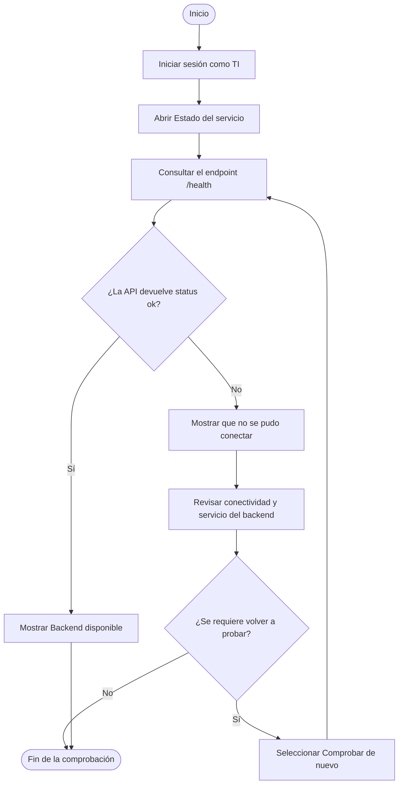
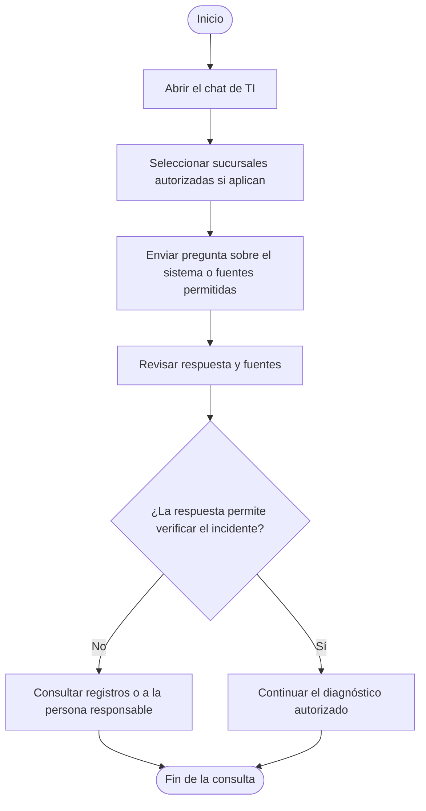

# Módulo de TI

## Navegación

- [Documentación general](0.DistribuidoraRio-Documentacion.md)
- [Módulo de Administración](1.Modulo-Admin.md)
- [Módulo de Analista](2.Modulo-Analista.md)
- [Módulo de Directivo](3.Modulo-Directivo.md)
- [Módulo de Gerente](4.Modulo-Gerente.md)
- [Módulo de Bodega](5.Modulo.Bodega.md)
- [Módulo de TI](6.Modulo-TI.md)

## Índice

- [Responsable](#responsable)
- [Objetivo](#objetivo)
- [Flujo del módulo: inicio a fin](#flujo-del-módulo-inicio-a-fin)
  - [Comprobación del backend](#comprobación-del-backend)
  - [Consulta técnica al asistente](#consulta-técnica-al-asistente)
- [Acciones del responsable de TI](#acciones-del-responsable-de-ti)
  - [1. Comprobar el backend](#1-comprobar-el-backend)
  - [2. Consultar al asistente de TI](#2-consultar-al-asistente-de-ti)
- [Alcance y restricciones](#alcance-y-restricciones)

## Responsable

Carlos, en el rol operativo **TI**.

## Objetivo

Comprobar la disponibilidad básica del backend y consultar al asistente sobre
el uso del sistema y la información técnica autorizada.

## Flujo del módulo: inicio a fin

La comprobación de salud y la consulta al agente son procesos independientes.
El estado correcto de `/health` solo confirma que responde el backend.

### Comprobación del backend

### Consulta técnica al asistente

## Acciones del responsable de TI

### 1. Comprobar el backend

1. Iniciar sesión con la cuenta activa de TI.
2. Consultar el panel **Estado del servicio**.
3. Revisar el resultado de la comprobación del endpoint `/health`.
4. Usar **Comprobar de nuevo** después de restablecer la conectividad o al
   investigar un reporte de indisponibilidad.
5. Si no hay conexión, verificar la disponibilidad y conectividad del backend
   según el procedimiento operativo del entorno.

Cuando el indicador informa que el backend está disponible, significa que
respondió correctamente a `/health`. No confirma que Azure AI Foundry, Azure AI
Search, Document Intelligence, Blob Storage u otros servicios externos estén
disponibles.

### 2. Consultar al asistente de TI

1. Abrir el chat del asistente de TI.
2. Seleccionar las sucursales autorizadas si la consulta depende de información
   segmentada por sucursal.
3. Preguntar cómo utilizar las funciones del sistema o por la información
   técnica permitida en las fuentes.
4. Revisar las fuentes que acompañan la respuesta y confirmar con los registros
   o responsables del servicio cuando se trate de un incidente.
5. Reportar cualquier dato ausente como pendiente de verificación, en lugar de
   asumir una causa.

## Alcance y restricciones

- El rol de TI puede consultar al agente y revisar la comprobación básica del
  backend; no dispone de una consola de administración de usuarios o
  infraestructura en este módulo.
- La comprobación de salud no es una prueba integral de los servicios Azure ni
  de los agentes.
- El asistente solo debe utilizar información autorizada y no debe recibir
  credenciales, tokens ni secretos.
- Las acciones de creación de agentes, configuración de índices y mantenimiento
  de servicios se realizan fuera de este panel mediante los procedimientos de
  operación autorizados.